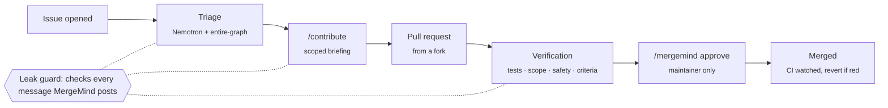

# MergeMind

**An AI teammate for GitHub that turns issues into verified fixes, made by the person who found the bug.**

Maintainers drown in issues. The contributor who reports a bug often understands it best, but handing a stranger
your code base is slow and risky. MergeMind closes that gap: it triages the issue against the real code, gives
the contributor a scoped briefing, verifies their pull request, keeps every secret out of the conversation, and
merges only when a maintainer says so.



| | |
|---|---|
| **Try it live** | [akii-codes/mergemind-tests-2.0](https://github.com/akii-codes/mergemind-tests-2.0): open an issue and watch it run. Finished example: [issue #1](https://github.com/akii-codes/mergemind-tests-2.0/issues/1) → [PR #2](https://github.com/akii-codes/mergemind-tests-2.0/pull/2) |
| **Use it on your repo** | **[SETUP_GUIDE.md](SETUP_GUIDE.md)**: about 20 minutes, runs free on GitHub Actions |
| **Results** | [evidence/](evidence/README.md): 450-issue backtest, 438 PRs, leak corpus, recovery runs |
| **Business model** | [cfo.ai plan](https://cfo.ai/s/PG56dy5YWbPcGD_b), built from measured token costs |
| **Hackathon write-up** | [hackathon.md](hackathon.md) |

---

## What it does

1. **Triage.** MergeMind investigates the actual code with **NVIDIA Nemotron** and **entire-graph**, then decides
   what kind of issue it is: accept, needs info, duplicate, question, feature review, security, or escalate.
   - Every claim cites evidence: code regions, call-graph impact, earlier issues.
   - A rule-based verifier and a separate critic must pass before anything is posted.
2. **Access.** On an accepted bug, the issue's author types `/contribute`.
   - **Access:** a fork workflow, or a time-limited collaborator invite.
   - **Briefing:** where the bug is, which files are in scope, the acceptance criteria, and how to write the
     regression test.
   - **Questions:** MergeMind answers the contributor's questions, through the leak guard.
3. **Verification.** The pull request is checked for:
   - merge conflicts;
   - scope and impact;
   - tests from a sandboxed workflow with no secrets, including a regression test that must fail without the fix;
   - a rules-only safety scan: CI edits, dependency changes, risky calls, committed secrets;
   - each acceptance criterion.
4. **Leak guard.** Every message passes through four checks before it's posted:
   - a secret scanner;
   - a restricted-path filter;
   - a scope filter for pasted code;
   - an LLM critic that fails closed.

   A message that can't be cleaned safely is held for a maintainer.
5. **Merge gate.** MergeMind merges only after a maintainer's `/mergemind approve`.
   - The PR author can't approve their own change.
   - The approved PR is re-verified against the latest base, and only the commit it checked is merged.
   - Afterwards it watches CI on `main` and opens a revert pull request if it turns red.

## Built with

| Tool | Role in MergeMind |
|---|---|
| **NVIDIA Nemotron** | Super with reasoning for the investigation, Lightning for fast checks: the leak critic and answers |
| **Entire** | entire-graph is the code-intelligence backend (search, definitions, impact: callers, tests, co-change), fused with a git-grep backend |
| **neatlogs** | One session per issue, with workflow, agent, tool and guardrail spans; versioned prompts; tagged backtest runs. Credentials are masked before export |
| **cfo.ai** | Unit economics and the business plan, from measured tokens per triage |
| **GitHub Actions** | The always-on runtime: one engine pass per event, with state on an orphan branch |

## Results

v2 on a leakage-free backtest of 450 real issues and 438 merged fix pull requests. All numbers are from the test
split (the newest 40%, never used for tuning). `[ ]` is the paired bootstrap 95% confidence interval of the v2 − v1
difference. Full table: [evidence/eval/v1-vs-v2.md](evidence/eval/v1-vs-v2.md).

| Measure | v1 | v2 |
|---|---|---|
| Fix file in MergeMind's top 3 | 0.68 | **0.74** [+0.01, +0.13] |
| Fix file in the top 5 (best baseline: 0.44) | 0.77 | **0.81** [−0.01, +0.10] |
| Share of the fix's test files MergeMind names | 0.50 | **0.74** [+0.18, +0.31] |
| Good pull requests held by the safety scan (false alarms) | 12% | **5%** [−11, −4 pts] |
| Fix pull requests touching a source file outside the allowed scope | 58% | **47%** [−16, −7 pts] |
| Full Nemotron triage, 18-issue sample: real bugs accepted | 9/18 | 9/18 (no measurable change) |
| Leak corpus: secrets or restricted content leaked | 0 | **0** |

Across all 438 pull requests, false-alarm holds dropped from 25% to 8%, and out-of-scope fixes from 61% to 45%. A full
triage costs about **$0.007** in LLM calls at hosted Nemotron list prices, and $0 on the free NVIDIA endpoint.

## Safety model

- **The LLM can't write anything.** Its tools are read-only, and every write goes through a rule-based policy
  gate.
- **Issue and pull request text are untrusted data.** Restricted files (`.env`, `deploy/`, keys, and so on) are
  never shown to the LLM.
- **Contributor code runs only in `mergemind-verify.yml`.** It uses the `pull_request` trigger with a read-only
  token and no secrets.
- **Keys live in a GitHub Environment limited to the default branch.** Contributors' branches and forks can't
  read them.
- **There are kill switches.** `/mergemind stop` pauses one issue; `autonomy: observe` or
  `MERGEMIND_AUTONOMY=observe` stops writes everywhere.

---

## Development

```bash
uv sync
```

Create `.env.local`. It's never committed.

```
NVIDIA_API_KEY=...       # build.nvidia.com
NEATLOGS_API_KEY=...     # optional: tracing
GITHUB_TOKEN=...         # fine-grained, one repository; see SETUP_GUIDE.md, step 1
```

**Entire (recommended).** Install the [Entire CLI](https://docs.entire.io/installation) and its graph plugin.
MergeMind then fuses entire-graph's ranking with a git-grep backend. Without Entire, only git-grep is used. On the
same issue, the investigator needed about half the tokens with entire-graph.

```powershell
irm https://entire.io/install.ps1 | iex      # Windows
entire plugin install graph
```

On macOS, install it with `brew install --cask entireio/tap/entire`; on Linux, with
`curl -fsSL https://entire.io/install.sh | bash`. Set `MERGEMIND_NO_ENTIRE=1` to force the fallback, or
`ENTIRE_BIN` to use a specific binary.

### Commands

| Command | What it does | Writes to GitHub? |
|---|---|---|
| `mergemind locate <issue-url>` | localize an issue in the code (no LLM) | no |
| `mergemind triage <issue-url>` | full triage with Nemotron | no |
| `mergemind preflight --repo o/r` | check token rights, branch protection, workflows, policy | no |
| `mergemind tick --repo o/r [--dry-run]` | one engine pass | yes, unless `--dry-run` or `autonomy: observe` |
| `mergemind run --repo o/r` | engine loop every 15 s (laptop mode) | yes |
| `mergemind actions-kit [DIR]` | write the GitHub Actions runtime into a repository | no |
| `mergemind sandbox-kit DIR -m <you>` | write a ready-to-push test repository | no |
| `mergemind eval-leak [--critic]` | run the seeded leak corpus | no |
| `mergemind eval dataset\|locate\|locate-v2\|triage\|pr-static\|compare\|economics` | the backtests behind `evidence/` | no |

### Tests

```bash
uv run pytest -q
```

### Layout

| Path | Contents |
|---|---|
| `src/mergemind/engine/` | issue state machine, effects, engine loop |
| `src/mergemind/agents/` | investigator, verifier, answerer, tool registry |
| `src/mergemind/code/` | entire-graph + git-grep localization, scope, impact |
| `src/mergemind/pr/` | pull request analysis and the safety scan |
| `src/mergemind/guard/` | leak guard, secret scanner, path rules |
| `src/mergemind/github/` | GitHub client, event ingestion, access, briefings |
| `src/mergemind/evals/` | backtests, leak corpus, economics |
| `src/mergemind/templates/` | the two workflow templates |
| `evidence/` | every measured result in this README |
| `site/` | the setup guide website (Next.js) |

The full design is in [buildplan-v2.md](buildplan-v2.md).
